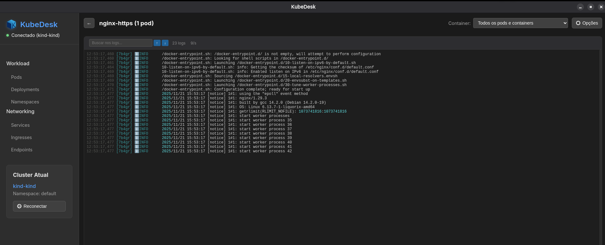
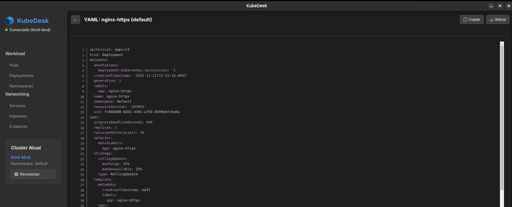
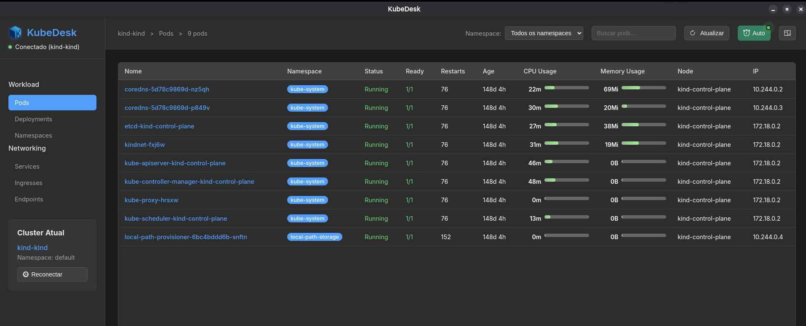

# KubeDesk

Uma ferramenta moderna e intuitiva para gerenciar clusters Kubernetes, inspirada no Aptakube, desenvolvida com Electron.

## 📸 Capturas de Tela

Aqui estão algumas capturas de tela da aplicação:







## 🚀 Funcionalidades

- **Multi-Cluster**: Conecte-se a múltiplos clusters Kubernetes
- **Interface Intuitiva**: Interface moderna e fácil de usar
- **Visualização de Recursos**: Visualize pods, deployments, services e namespaces
- **Zero Configuração**: Funciona com seu arquivo kubeconfig existente
- **Tempo Real**: Atualização automática de status dos recursos
- **Busca e Filtros**: Encontre recursos rapidamente

## 📋 Pré-requisitos

- Node.js 22.12 ou superior
- npm
- Arquivo kubeconfig configurado

## 🛠️ Instalação

1. Clone o repositório:
```bash
git clone <seu-repositorio>
cd kubernetes-tool
```

2. Instale as dependências:
```bash
npm install
```

3. Execute a aplicação:
```bash
npm start
```

Para desenvolvimento (recarrega o renderer ao salvar):
```bash
npm run dev
```

Testes e checagem de tipos:
```bash
npm test
npm run typecheck
```

## 🏗️ Build

Para criar os instaladores:

```bash
npm run dist          # sistema atual
npm run dist:linux    # ou dist:win / dist:mac
```

Os instaladores são criados em `dist/`. O `npm run build` só compila o app para `out/`.

## 📖 Como Usar

1. **Primeira Execução**: A aplicação tentará carregar automaticamente seu arquivo kubeconfig padrão (`~/.kube/config`)

2. **Seleção de Cluster**: 
   - Se você tiver múltiplos clusters, selecione o desejado no dropdown
   - Clique em "Conectar"

3. **Navegação**:
   - Use o menu lateral para navegar entre diferentes recursos
   - Filtre por namespace usando o seletor no topo
   - Use a caixa de busca para encontrar recursos específicos

4. **Atualização**: a lista de pods acompanha o cluster em tempo real (watch), sem precisar atualizar

## 🎯 Recursos Disponíveis

- **Pods**: Visualize todos os pods com status, restarts, idade e informações do nó
- **Deployments**: Gerenciar deployments (em desenvolvimento)
- **Services**: Visualizar services (em desenvolvimento)
- **Namespaces**: Listar e gerenciar namespaces

## 🔧 Desenvolvimento

### Estrutura do Projeto

```
src/
├── main/                 # Processo principal (Node): fala com o cluster
│   ├── index.ts          # Janela e segurança
│   ├── ipc.ts            # Handlers IPC e assinaturas (watch, logs)
│   └── kube/             # Conexão, status de pods, watch, logs
├── preload/index.ts      # Única ponte entre a página e o Node (window.kube)
├── shared/api.ts         # Tipos do contrato entre os processos
└── renderer/             # Interface em Svelte 5, sem acesso ao Node
    └── src/
        ├── components/   # Telas
        └── lib/          # Estado da sessão, ordenação, formatação
legacy/                   # App antigo, referência até o porte terminar
```

Detalhes da arquitetura e do que falta portar em `REFACTOR_PLAN.md`.

### Tecnologias Utilizadas

- **Electron** com `contextIsolation` e `sandbox`
- **TypeScript**, **Svelte 5** e **electron-vite**
- **@kubernetes/client-node**: cliente oficial do Kubernetes para Node.js
- **xterm.js**: visualizador de logs
- **Vitest**: testes

## 🚧 Roadmap

- [ ] Métricas de CPU e Memória
- [ ] Logs agregados de múltiplos pods
- [ ] Port forwarding
- [ ] Editor YAML integrado
- [ ] Ações rápidas (restart, scale, delete)
- [ ] Comparação de recursos entre clusters
- [ ] Suporte a Helm charts
- [ ] Temas (claro/escuro)

## 🤝 Contribuição

Contribuições são bem-vindas! Por favor:

1. Fork o projeto
2. Crie uma branch para sua feature (`git checkout -b feature/AmazingFeature`)
3. Commit suas mudanças (`git commit -m 'Add some AmazingFeature'`)
4. Push para a branch (`git push origin feature/AmazingFeature`)
5. Abra um Pull Request

## 📄 Licença

Este projeto está licenciado sob a Licença MIT - veja o arquivo [LICENSE](LICENSE) para detalhes.

## 🙏 Agradecimentos

- Inspirado no [Aptakube](https://aptakube.com)
- Baseado no cliente oficial Kubernetes para Node.js
- Comunidade Electron

## 📞 Suporte

Se você encontrar algum problema ou tiver sugestões, por favor abra uma issue no GitHub.
